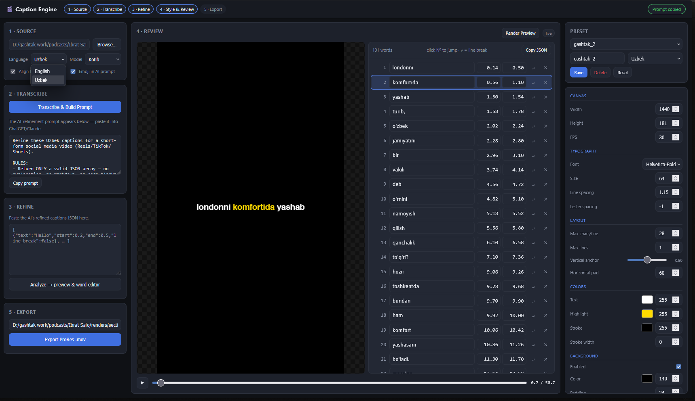
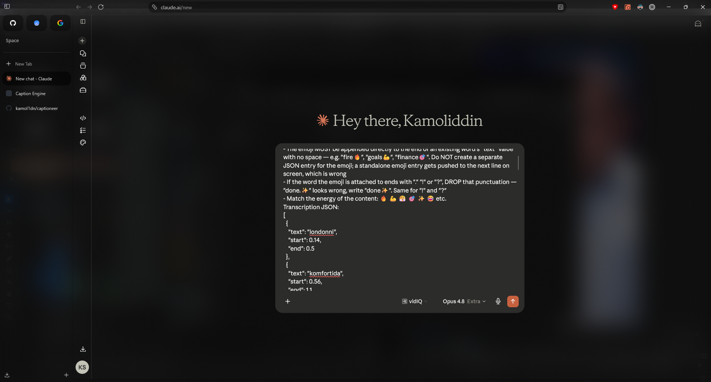
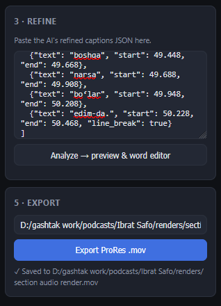
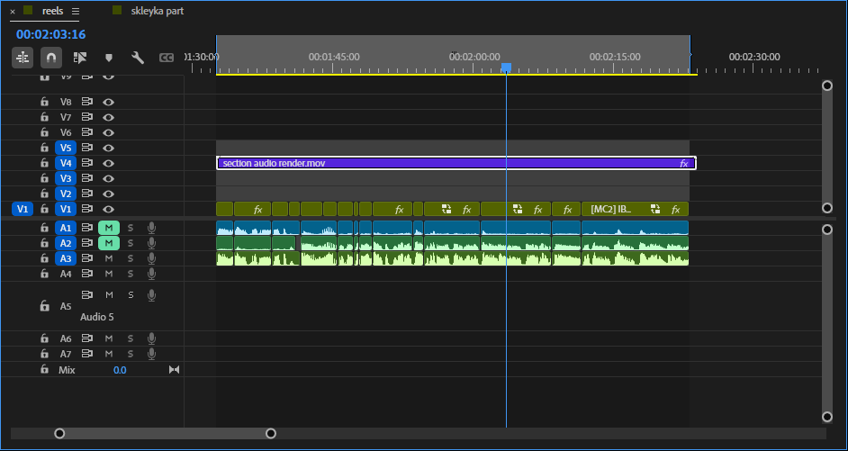
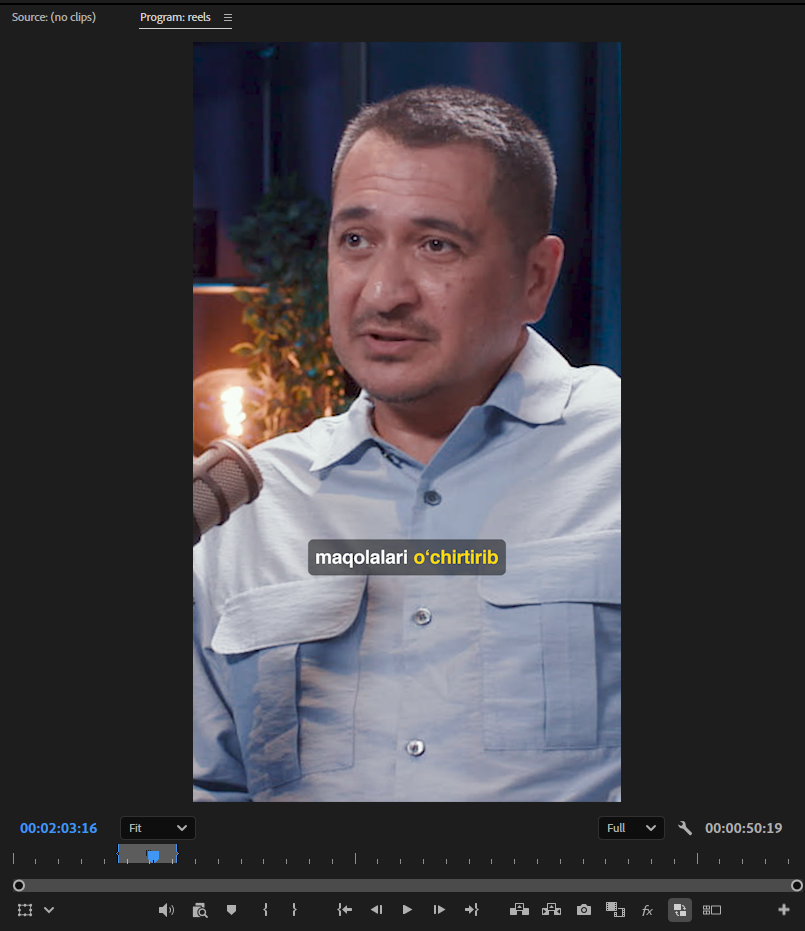

this is totally vibecoded project, but literally saves 95% of my time, idk if it fits your workflow

# Captioneer

An editing engine for podcast and interview shows, driven by Claude Code and
delivered into Premiere Pro. It started as an offline word-by-word caption
generator. It now takes a recorded multicam episode and turns it into finished
work: vertical reels cut from the transcript, word-highlighted captions,
animated graphics, long-form overlays, and edits placed straight into a live
Premiere timeline.

The editor stays in charge. Claude proposes and builds; everything lands in
Premiere as ordinary clips, tracks and sequences that can be changed by hand.

| Piece | What it does |
| --- | --- |
| **Clipper** (`clipper/`) | Multicam episode in, short vertical clips out: transcript, camera switching by who is speaking, cuts snapped to silence, joins checked by ear, one FCP7 XML for Premiere |
| **Caption engine** (`caption_engine/`) | Local transcription (English and Uzbek) and word-by-word caption overlays as transparent ProRes 4444 `.mov`; also a browser app for one-off videos |
| **Graphics** (`graphics/`) | Remotion templates rendered to alpha ProRes at the clip's exact size, rate and length: hooks, stat cards, charts, full-screen explainers |
| **Long-form** (`longform/`, `clipper/panels.py`) | Graphics for the panes of a show's long-form layout, page screenshots with phrase marks, retitled text layers |
| **Skleyka** (`skleyka/`) | A live bridge into Premiere: reads the editor's multicam edit, transcribes it, and places graphics, sounds and baked cards on its own tracks |
| **Long captions** (`long_captions/`) | Traditional `.srt`/`.vtt` subtitles for full episodes |

Claude Code drives the clipper and Skleyka through their MCP servers
(`.mcp.json`), following the skills in `.claude/skills/` (`clip-episode`,
`broll-pass`).

## How it is organised

The engine is generic. Everything that belongs to one client, and everything
made for one episode, lives outside it:

```
captioneer/                 this repo: the engine, public
  caption_engine/ clipper/ graphics/ longform/ skleyka/ long_captions/
  shows/                    the client tier, gitignored (see shows/README.md)
    <show>/                 one folder per client, normally its own private repo
      show.json             reel dressing: graphics family, whooshes, outro card
      captions.json         the show's caption presets
      templates.json        its own graphic templates...
      graphics/             ...and their Remotion components
      fonts/                its licensed faces
      longform.json         its long-form layouts
      RULES.md              how this client's episodes are edited

<episode folder>/           next to the episode's Premiere project
  clipper/                  the clipper project: transcript, EDL, captions, renders
  skleyka/                  Skleyka's scenes, staged footage, renders
  longform/                 long-form plans and build scripts
```

A show's graphics are copied into the Remotion bundle before every render
(`graphics/sync-shows.mjs`), and its caption presets join the preset library
when it loads. With no shows at all, the engine still cuts, captions and renders
with its own default look. Set `CAPTIONEER_SHOWS` to keep the shows folder
somewhere else.

**Adding a client** is a new folder under `shows/`: a `show.json` (even just
`{"name": "..."}`), any presets or graphics it needs, and a `RULES.md`. Projects
name it with `show`, and the skills read its rules before working.

## Setup

Windows, one click: double-click **`run.bat`**. The first launch installs
Python 3.12, PyTorch (the GPU build if there is an NVIDIA card), the
transcription libraries, and wires the bundled FFmpeg 7.1 into place. That is a
few GB and can take 10 to 30 minutes; later launches open the caption app at
`http://127.0.0.1:8765` in seconds. The speech models download on first use.

By hand (`run.command` does this on macOS):

```bash
py -3.12 -m venv venv
venv/Scripts/python -m pip install -U pip
# GPU (CUDA 12.8) build of torch; plain PyPI serves CPU-only wheels:
venv/Scripts/python -m pip install torch==2.8.0 torchaudio==2.8.0 torchvision==0.23.0 \
    --index-url https://download.pytorch.org/whl/cu128
venv/Scripts/python -m pip install -r requirements.txt
```

See the header of `requirements.txt` and `run.bat` for exact versions and the
torchcodec/FFmpeg DLL wiring.

Graphics need Node 18+:

```bash
cd graphics
npm install
npm run studio      # syncs the shows' graphics, then opens Remotion Studio
```

Skleyka needs its CEP panel signed and installed in Premiere once:
`skleyka/scripts/sign-panel.ps1` (see `skleyka/README.md`).

## Cutting reels: the clipper

Turn a long multicam episode into short vertical clips and export them as a
Premiere-importable FCP7 XML timeline. Claude makes the edit decisions from the
transcript; Premiere does the rendering.

Create a project from the camera exports (or straight from the episode's
`.xml` timeline, one V-track per angle), `ingest` to compute per-camera loudness
and a word-level, optionally speaker-diarized, transcript, then pick moments and
camera cuts into an **EDL** (kept ranges in master seconds plus
`{at, camera, why}` switches). Every boundary snaps to silence; `check_segments`
reads the joins and `verify_clip_audio` re-transcribes the concatenated audio
to catch clipped words. Captions render per clip through the caption engine,
and the export writes one XML with every clip as its own sequence. Each sequence
stacks one video track per camera with only the live angle enabled, so the
editor can flip an angle with a track toggle and no re-export.

The second pass, b-roll and graphics (`broll-pass` skill), runs over a finished
cut: animated cards over the speaker, full-screen frames, stock footage that
Claude shortlists and the editor downloads, whooshes and outro cards from the
show's dressing.

```bash
# CLI mirror of every MCP tool, for real Python tracebacks
python -m clipper create-project "EP12" --camera A=CamA.mp4 --camera B=CamB.mp4 --primary A
python -m clipper ingest 2026-07-20_ep12 --diarize --wait
python -m clipper outline 2026-07-20_ep12
python -m clipper set-edl 2026-07-20_ep12 --file edl.json
python -m clipper export-xml 2026-07-20_ep12
```

## Long-form

`longform/` makes graphics for the transparent panes of a show's 4K long-form
layout: page screenshots with highlighted phrases (`longform.shoot`), timed
panels rendered at the pane's own size (`clipper.panels`), and text layers
retitled across the timeline (`clipper.headlines`). See `longform/README.md`.

`skleyka/` works inside Premiere itself. The editor syncs and switches angles
by hand in a real multicam sequence; Skleyka reads that edit (the active angle
of every cut comes from the saved `.prproj`), transcribes it in edit time, finds
the free space in each shot, and places rendered graphics, sounds and baked
glass cards on its own `SKL` tracks. It never flattens or rewrites the editor's
sequence. See `skleyka/README.md`.

## Captions

The caption engine renders word-by-word, highlighted captions to transparent
ProRes 4444 `.mov` files that drop onto a track above the footage in any NLE.

| Backend | Used for | Word timing |
| --- | --- | --- |
| **WhisperX** | English (default) | Forced alignment, about ±20-50 ms |
| **faster-whisper** | English, `--no-align` | Inferred, drifts ±100-300 ms |
| **Kotib + MMS** | Uzbek (`language=uz`) | MMS forced alignment |
| **Verbatim** | English editing (clipper default) | MMS alignment, extents measured from the audio |

Verbatim is for cutting, not captioning. Whisper deletes "um" and "uh" and
folds their time into neighbouring words, so a pause in its transcript can be a
filler and a cut placed there lands in it. The verbatim backend runs
[CrisperWhisper](https://github.com/nyrahealth/CrisperWhisper)
(`nyralabs/faster_CrisperWhisper`, non-commercial licence), which keeps fillers
as tokens, then force-aligns each chunk with MMS and measures every token's
start and end from the audio. Captions never show the fillers.

Every visual setting is a field on the `CaptionStyle` dataclass: font, size,
tracking, colors, stroke, background box, highlight mode (`none`/`scale`/`box`),
phrase fades, hold across gaps. Presets live in `preferences.json` (seeded from
the built-ins, plus each show's `captions.json`) and are editable in the app.

### The caption app

For one-off videos, `run.bat` opens a local browser app that walks through
five steps: pick a source, transcribe, optionally paste a generated prompt into
a chat model to fix spelling, line breaks and emoji, style and review with a
live preview, and export.



| Paste the prompt into any chat model | Paste the refined JSON back and export |
| :---: | :---: |
|  |  |

| The `.mov` on a timeline track | Composited over the footage |
| :---: | :---: |
|  |  |

From the command line or Python:

```bash
python -m caption_engine.cli my_reel.mp4 -o captions.mov --preset reels_classic
# transcribe once, restyle many times
python -m caption_engine.cli my_reel.mp4 --transcribe-only -j words.json
python -m caption_engine.cli --from-json words.json -o v2.mov --preset punchy_green
```

```python
from caption_engine import make_captions
make_captions("reel.mp4", "out.mov", preset="reels_classic")
```

Long-form subtitles: `python -m long_captions.subtitle_gen lecture.mp4 -o lecture.srt --language uz`.
Long audio is sliced into silence-snapped windows, so Uzbek MMS alignment stays
within a flat VRAM budget however long the episode is.

## Architecture

```
caption_engine/   transcription backends, phrase layout, CaptionStyle, Pillow -> ffmpeg renderer,
                  preset store, browser app (web/), shows.py (where the client tier lives)
clipper/          ingest / diarize / energy        loudness envelopes + word-level transcript
                  edl / compile / xmeml            EDL -> compiled clips -> FCP7 XML
                  sanity / verify                  joins checked in text and by re-transcription
                  captions / graphics / stock      per-clip captions, rendered graphics, stock b-roll
                  show.py                          a show's reel dressing
                  panels / headlines               long-form panes and text layers
                  mcp_server.py, __main__.py       clipper-engine MCP server and its CLI mirror
graphics/         Remotion: the engine's default templates (templates.json), render.mjs, sync-shows.mjs
longform/         screenshots with phrase marks, word timings, plan templates
skleyka/          Premiere bridge: CEP panel, ExtendScript helpers, MCP server, placement, baking
long_captions/    .srt/.vtt generator
ffmpeg-7.1/       bundled FFmpeg
assets-fonts/     the engine's free fonts (Montserrat)
.claude/skills/   clip-episode and broll-pass: how Claude runs the pipeline
```

Tests are plain modules: `python -m clipper.tests.test_cuts` (one per file in
`clipper/tests/`) and `python -m skleyka.tests.run`.
